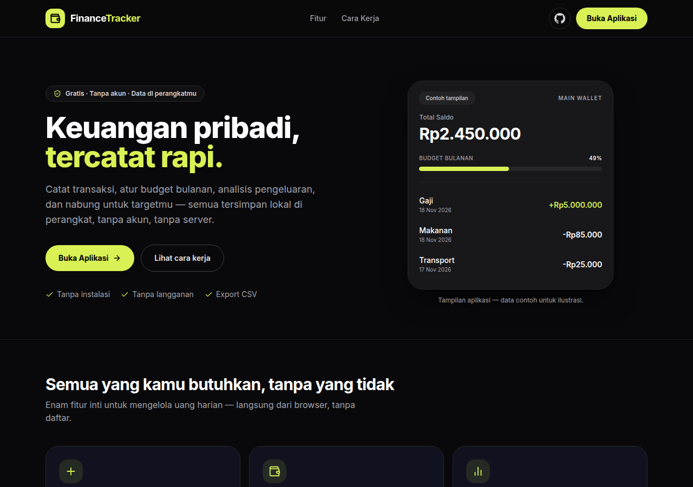
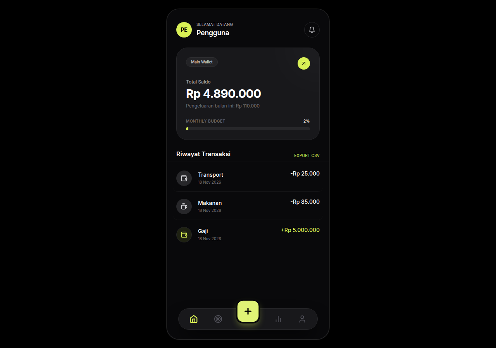
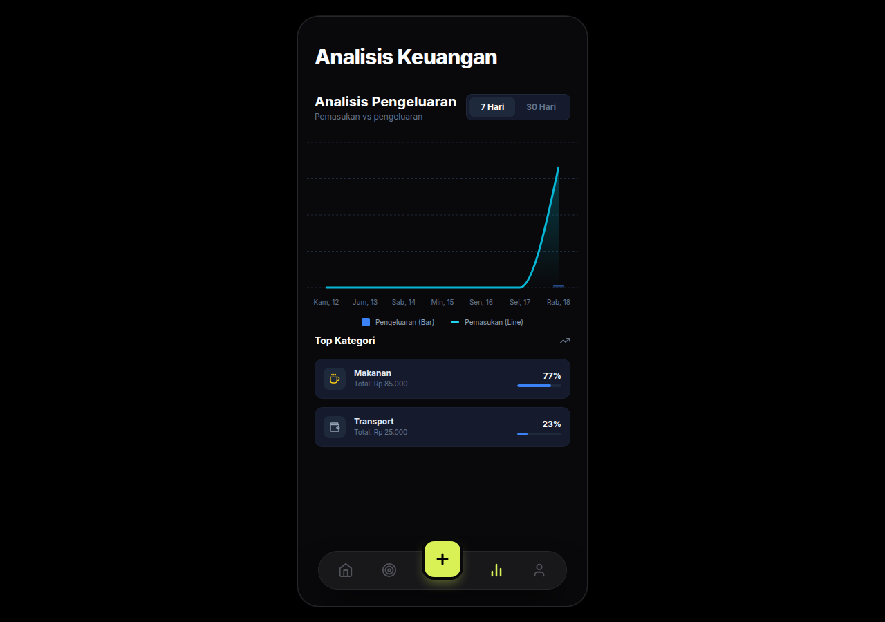
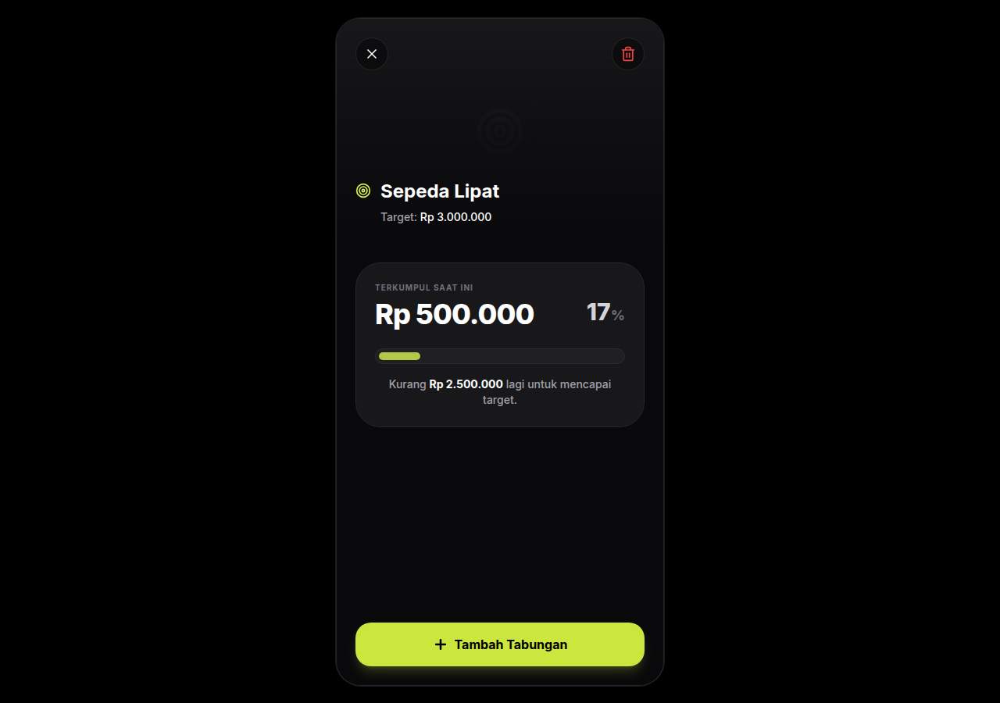
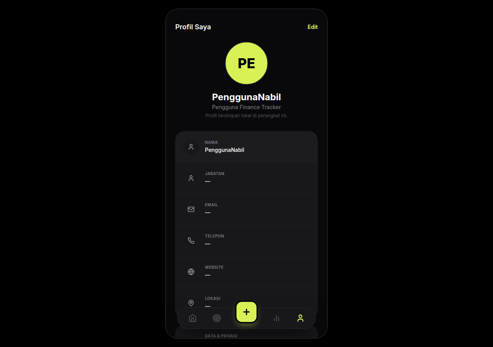
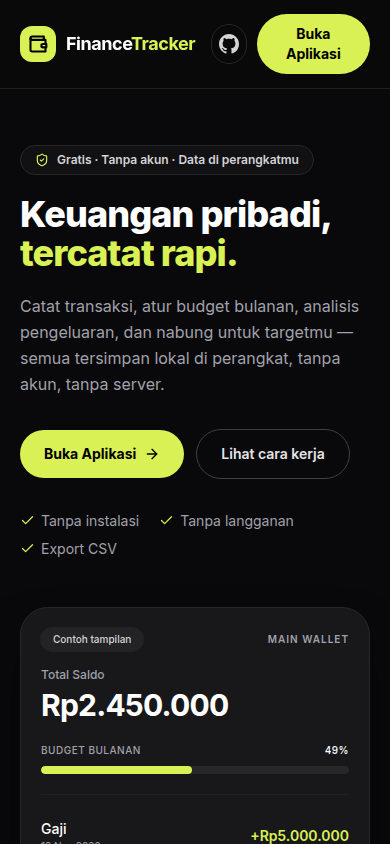
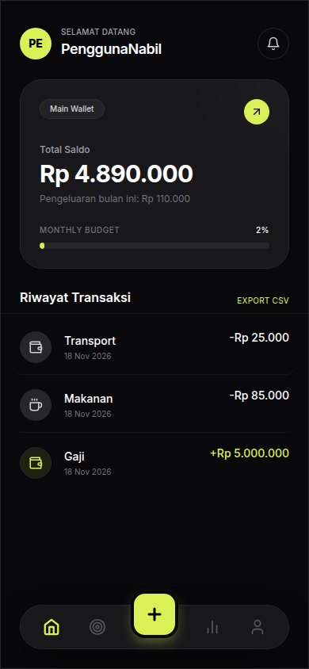

# Finance Tracker

Aplikasi manajemen keuangan pribadi — pencatatan transaksi, budget bulanan,
analisis pengeluaran, dan target tabungan. Dibangun dengan Next.js +
Recharts, data tersimpan lokal di perangkat (IndexedDB), tanpa akun dan
tanpa server.

## 🌐 Live Demo

**https://lacak-duit.pages.dev**

## ✨ Fitur

- **Landing page SaaS** — navbar, hero + preview produk, fitur, cara kerja.
- **Catat transaksi** — pemasukan/pengeluaran, 7 kategori, catatan, hapus transaksi.
- **Budget bulanan** — kartu Total Saldo + progres pemakaian budget Rp5.000.000.
- **Analisis pengeluaran** — grafik combo (area pemasukan + bar pengeluaran)
  7/30 hari terakhir + kategori teratas.
- **Target tabungan** — buat target (nama, target Rp, foto opsional), top-up
  tabungan sampai 100%.
- **Profil** — data diri bisa diedit (tersimpan lokal), export CSV, hapus semua data.
- **Privasi lokal** — semua data di IndexedDB + localStorage perangkatmu. Tanpa akun.

## 📸 Tampilan















## 🎬 Video Demo

[](docs/demo/demo.mp4)

> Video demo (21,7 detik, tanpa suara): landing → tambah transaksi →
> analisis → target tabungan. Klik gambar di atas untuk memutar
> [`docs/demo/demo.mp4`](docs/demo/demo.mp4).

## 🛠 Tech Stack

- Next.js 14 (App Router, static export) + React 18 + TypeScript
- Tailwind CSS + lucide-react
- Recharts (grafik analisis)
- IndexedDB via `idb` (transaksi + wishlist), localStorage (profil)

## 📁 Struktur Proyek

```
app/                # layout, halaman utama, favicon & ikon
components/         # LandingPage, Header, BudgetCard, ActivityList,
                    # SpendingAnalysis, BottomNav, AddTransactionModal,
                    # Profile/, Wishlist/
lib/                # db.ts (IndexedDB), profile.ts, exportCSV.ts, utils.ts
types/              # Transaction, WishlistItem
public/             # manifest.json, icon-192/512.png
docs/               # architecture.md, diagrams/app-flow.svg,
                    # screenshots/, demo/demo.mp4
.github/workflows/  # CI (typecheck + build + Lighthouse)
```

## 🚀 Menjalankan Lokal

```bash
npm install
npm run dev        # http://localhost:3000
```

```bash
npm run build      # static export ke out/
npm run typecheck  # tsc --noEmit
```

## 📄 Dokumentasi

- [PRD v2.0](PRD.md)
- [Arsitektur](docs/architecture.md) + [diagram alur](docs/diagrams/app-flow.svg)
- [CHANGELOG](CHANGELOG.md)

## 📄 Lisensi

MIT — lihat [LICENSE](./LICENSE).
